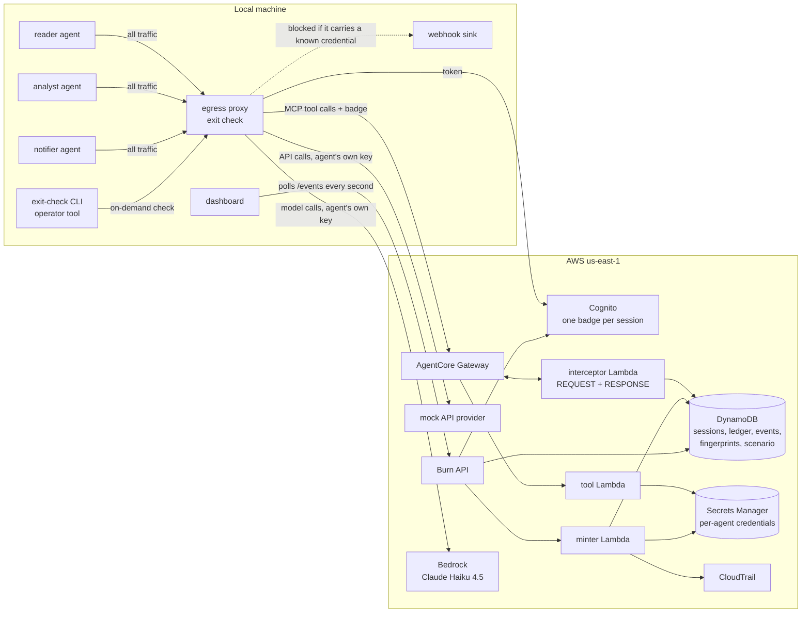

# Architecture

Burn contains a compromised AI agent in one action: revoke its badge, rotate every credential it
owns, flag the credentials it saw that others own, and show recorded use of its AWS key.
Agent-owned credentials are issued separately so rotating one agent's copies does not rotate
another's. Shared credentials remain shared and require their owner's response. The current
demo routes tool calls through the Gateway and outbound agent traffic through the proxy.

## Components

| Component | Where | What it does |
|---|---|---|
| Agents (`agents/`) | Docker, internal network only | Three Strands agents on a fixed graph (reader → analyst → notifier). Each calls Claude with its **own** minted AWS key and calls tools through the Gateway with its **own** badge. Stops when its badge is refused. |
| Egress proxy (`detection/proxy`) | Docker, the only agent-facing container on both networks | Authenticates each agent's session, refuses inactive sessions, applies deployment and session destination restrictions, and runs the exit check on outbound requests. |
| AgentCore Gateway (`gateway/`) | AWS | MCP endpoint for the tools. Inbound auth is a Cognito JWT with scope `burn/tools`. |
| Interceptor Lambda (`gateway/lambdas/interceptor`) | AWS | **REQUEST:** looks up the badge's session in DynamoDB on every call and refuses revoked or unknown badges and tools outside the agent's allowlist; scans `send_message`/`notify` arguments and blocks known credentials. **RESPONSE:** scans the tool output and writes every credential found to the agent's exposure ledger. |
| Tool Lambda (`gateway/lambdas/tools`) | AWS | Tickets, config files, customers, messages. Scenario data comes from a data file; credential placeholders are filled from Secrets Manager at read time, so a file shows the current key. |
| Minter (`minter/`) | AWS | The only component that creates credential values. Per agent: a mock-provider API key and an IAM user + access key (inside a permissions boundary). Registers HMAC fingerprints. Rotates, flags, deletes. Queries CloudTrail by access key id. |
| Mock API provider (`minter/lambdas/provider`) | AWS | Accepts only the current version of each agent's API key, so a rotated key is visibly rejected. |
| Burn API (`burn_api/`) | AWS | Sessions, burn, blast radius, event feed, per-agent ledger. |
| Detection library (`detection/burn_detect`) | Shared by gateway, proxy, eval | Decodes common encodings, matches exact and partial (shingle) fingerprints, accumulates evidence across a session's recent requests, and flags known credential formats. |
| Dashboard (`dashboard/`) | Browser | Agents, live events from real traffic, ledger, Burn button and blast-radius timeline. |
| Exit-check CLI (`detection/leaktest`) | Operator terminal | On-demand verification through the proxy with `make exit-check-test AGENT=...`; reports blocked/allowed and the reason without exposing credentials. |

## Core flows

**Session start.** `POST /sessions` → the minter issues (or reuses) the agent's credentials →
the Burn API creates one Cognito app client for this session (the badge) and writes the session
row with the agent's tool allowlist → `issued` event.

**Tool call.** Agent → proxy → Gateway with its badge token → interceptor REQUEST reads the
session (consistent read) → tool runs → interceptor RESPONSE scans the output → every credential
found is upserted into `burn-exposures` with a `recorded` event → the agent gets the output.

**Agent-to-agent message.** `send_message` arguments are scanned at REQUEST. A known credential,
in any decoded form, blocks the call (`blocked`, source `handoff`). A clean message is delivered,
and the receiver inherits the sender's ledger entries (`inherited`), because the receiver may
now hold derived information.

**Exit check.** Every request leaving the agents' network goes through the proxy. URL, query,
headers and body are decoded and compared against the fingerprints of every credential Burn
minted (current and rotated). A match is blocked with a `blocked` event. Two destinations are
inside the trust boundary and skip the body check: Bedrock (the model legitimately sees tool
output in the conversation) and the Gateway (its interceptor checks arguments). A credential
going to its own home service in its expected header is not a leak.

The proxy permits only exact configured destinations. Session `egress` lists can narrow the
deployment allowlist, while missing or null lists retain legacy defaults. S3 is restricted to
the demo's HTTPS `GET /` bucket-list operation without a query or body. The default configured
sink is deliberately readable by the simulated attacker. An empty `BURN_SINK_URL` removes its
allowlist entry and private-address exception; other destinations still need capability and
access-control review. A deny-all configuration is not a usable zero-exposure result.

**Burn.** `POST /burn {agent_id}`:
1. Every active session of the agent is marked `revoked` in DynamoDB and its Cognito client is
   deleted. The DynamoDB flag is the real kill switch: tokens already issued stay valid at Cognito
   until they expire, but the interceptor refuses them on the very next call.
2. The minter rotates every credential the agent **owns**. The API key gets a new value, and the
   old one stays only as `AWSPREVIOUS` for the replay demo. The AWS key gets a new access key and
   the old one is set to Inactive. The agent loses model access too, because it called Bedrock
   with that key.
3. Every credential in the agent's ledger that it does **not** own (shared, or another agent's)
   is flagged for review instead of rotated, so no other agent breaks.
4. `GET /burn/{agent}/blast-radius` returns CloudTrail activity for the agent's current and
   previous access keys.

## Data

| Store | Contents |
|---|---|
| `burn-sessions` | One row per badge: agent, Cognito client id, status, tool allowlist, allowed recipients |
| `burn-exposures` | The ledger: which credentials each agent has seen, from which tool or which sender |
| `burn-events` | Append-only event stream (ULID ids, so the dashboard polls with `since=`) |
| `burn-credentials` / `burn-fingerprints` | Credential registry and HMAC-SHA256 fingerprints (exact + 8-char shingles) |
| `burn-scenario`, `burn-messages` | Scenario data loaded from YAML, agent inboxes |
| Secrets Manager `burn/<agent>/*` | Persistent credential vault; private runtime environments also receive the values they need |

Ledger and event records store credential references and keyed fingerprints rather than raw
values. The dashboard reads that metadata. The HMAC key is generated by AWS at deploy time.
Runtime credential files under `.run/` and local configuration stay private and gitignored.

## Contract and runtime scope

The API contract also defines roles, enrollment tokens, instances and scoped burns. Their
mock implementation supports development independently of deployed handlers. A contract or
mock route alone does not establish that the corresponding real API route is deployed.
Canaries and secret references belong to separate component implementations; evaluations
must identify the source checkout and the actual path they exercised.

## Identity and least privilege

- Each Lambda has its own role, scoped to the fixed table and secret names it uses. No execution
  role has wildcard actions. CloudTrail `LookupEvents` is the one resource `*`, because that API
  has no resource-level permissions.
- The minter can create IAM users only under `/burn-agents/`, and only with the
  `burn-agent-boundary` permissions boundary attached. It is explicitly denied removing that
  boundary, so a compromised minter cannot mint an admin.
- The proxy runs as its own IAM user with read-only access to sessions and fingerprints and
  write access to events only.
- Agents run with nothing but their own minted credentials. There is no fallback to the host's
  AWS credentials.

## Known limits

- Detection catches the common re-encodings, but a novel transformation (for example
  gzip+base64, base32, ROT13) can slip past. The destination allowlist is the backstop. Measured
  numbers are in `eval/RESULTS.md`.
- CloudTrail event history lags real activity by several minutes, so the blast radius of a key
  used seconds ago can be empty at first.
- Cognito does not revoke issued access tokens. Burn relies on the per-call DynamoDB check,
  which adds a small, measured latency to each tool call.
