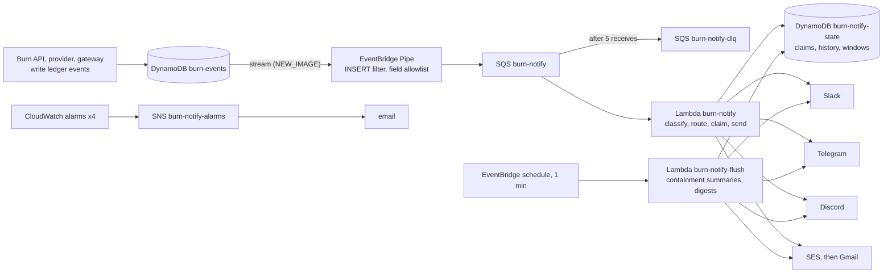

# Burn Notifications: verification report

All times are UTC on 2026-11-08 and come from provider responses, AWS records or mailbox headers
captured during testing. Nothing here is estimated unless it says so.

## In 30 seconds
When Burn contains a compromised AI agent, the people responsible need to know right away, and
they need the truth. Burn Notifications reads every event Burn writes to its ledger and turns the
ones that matter into alerts in private Slack, Telegram, Discord and email channels. It follows up
with a summary of what Burn actually did: was the session revoked, were the credentials rotated,
were shared credentials flagged.

It never claims more than the evidence shows:
- A canary alert says "awaiting verified outcome".
- A failed rotation is reported as CRITICAL, never as a success.
- Credential values are never sent anywhere.

It runs as its own serverless pipeline beside Burn, so a broken chat provider can never slow Burn
down.

## What it does
- **Classifies** Burn's real ledger events: canary use, blocked disclosures, flag levels,
  revocations, rotations, rotation failures and replacements. Each gets a severity and fixed,
  evidence-based wording.
- **Delivers** to Slack (Block Kit), Telegram (Bot API), Discord (embeds, with mentions disabled) and
  email (Amazon SES, with a text and an HTML part).
- **Follows up:** about a minute after a containment update, a summary reports only the results Burn
  recorded since that revoke.
- **Tracks** every delivery per destination, and deduplicates, retries, aggregates and rate-limits.

## Architecture

AWS services used: DynamoDB Streams, EventBridge Pipes, EventBridge Scheduler rules, SQS (with a
DLQ), Lambda (Python 3.12), Secrets Manager, SES (domain identity with DKIM), CloudWatch (EMF
metrics, alarms, logs) and SNS.

## Kinds of evidence
| Kind | Meaning | Where |
|---|---|---|
| Local | Unit tests with mocked providers | `notifications/tests` |
| Emulated | AWS emulated by moto in-process, real sockets against a local TLS server, and Burn's real containment code in its canary harness | `test_aws.py`, `test_transport_real.py`, `test_backend_demo.py` |
| Deployed | The real stack in the team AWS account, real providers | this report |
| End to end | A ledger row goes through the stream, Pipe, SQS and Lambda to a provider, and is seen arriving | this report |

## Results
| Requirement | Result | Kind | Evidence |
|---|---|---|---|
| Slack delivery | PASS | deployed, end to end | Ledger events at 08:46 and queued events at 09:05 delivered on the first attempt; the alert, containment update and summary were seen in the private `#burn-security-test` |
| Telegram delivery | PASS | deployed, end to end | Telegram message ids 24–33 for the 08:46–09:06 tests; every event id and the CRITICAL summary seen in the private bot chat |
| Discord delivery | PASS | deployed, end to end | Discord message ids returned (for example `1568909643424469156` for the CRITICAL alert `evt_01M6X5D4HT549H5M4YBKNYHRED`); seen in the private channel |
| Gmail delivery | PASS | deployed, end to end | Alert 09:05:19, update 09:05:20, summary 09:06:31, all in the inbox; Gmail headers show `dkim=pass`, `spf=pass`, `dmarc=pass` for `alerts.shikharsisodia.tech` |
| AWS pipeline | PASS | end to end | 9 ledger rows written at 08:46: 6 HIGH or above were delivered 24/24 on the first attempt and 3 LOW were correctly not routed; 8/8 summaries sent by the flush Lambda; DLQ empty; 0 Lambda errors |
| Containment summary | PASS | end to end | It reports only results recorded since the revoke ("Rotated where confirmed (1)"); a failed rotation produced a CRITICAL "NOT rotated (rotation failed)" |
| Stream survives normal deploys | PASS | deployed | #120 merged; `cdk diff BurnData` from `main` showed "There were no differences"; stream enabled |
| Live retries and DLQ | PASS (Retry-After not tested live) | deployed, isolated | See "Retry and DLQ" below |
| Alarm notifications | PASS | deployed | SNS email subscription confirmed; an `ALARM: "burn-notify-queue-age"` email arrived at 09:21:25 (the alarm state was set by test, then returned to OK) |
| Secret redaction | PASS | local, deployed | Fake secret markers in every sensitive field never appeared in any payload or stored provider copy; Lambda logs had 0 webhook or token strings |
| Manual Burn on live AWS | BLOCKED | n/a | Needs a signed-in operator (people sign-in is on); deferred by the workstream owner |
| Automatic canary containment on live AWS | BLOCKED | n/a | The deployed Gateway never puts a session's canary in tool output. The minimal fix is PR #124 (awaiting owner approval) |
| Rotation and worker continuity | PASS (emulated only) | emulated | Burn's real canary code in its harness: victim session revoked, 2 owned keys rotated, 4/4 other sessions still active, provider answered 401 to the canary |

### Message delivery evidence (deployed)
- **Real Burn ledger rows through the full pipeline**, at 08:46: `evt_01M6X5D3FK1N4M2MAPFA8937GG` (canary
  used), `…D3T0NK7YK6VTJ4DBKKQ4` (revoked), `…D49X8NKNPZPV0V3DJCMH` and `…D4DTS4KH9KWZZTG2K1NH` (second
  incident), `…D4HT549H5M4YBKNYHRED` (rotation failed, CRITICAL) and `…D4NRRSCSP1ESW90EYPB8`
  (redaction probe). Each was delivered to Slack, Telegram, Discord and email on the first attempt.
- **Email through the deployed pipeline**, at 09:05–09:06 (queue test envelope, labelled `[TEST]`):
  canary alert, containment update and summary, all in the Gmail inbox.

### Burn's real containment code driving notifications (emulated AWS, real providers)
`demo/backend_demo.py` runs Burn's provider, Burn API canary containment and minter in-process on
moto, and sends the events they write to the real channels:
- **Contained:** canary used, then the session revoked, then a summary "Rotated where confirmed (2)".
  4/4 other sessions stayed active. Delivered to Discord and Telegram at 08:15 and 08:27.
- **Rotation failure:** a CRITICAL "Containment incomplete: credential rotation failed … NOT rotated",
  then a CRITICAL summary. Nothing claimed success.

### Retry and DLQ (deployed, isolated, then removed)
A disposable queue (DLQ after 3 receives), a state table and a Lambda running the deployed code. One
healthy destination (the private Discord channel) and one Teams-shaped endpoint on a host that does
not resolve, so the failure was controlled and reached no real provider.

| Time | Receive | Discord (healthy) | Teams (unreachable) |
|---|---|---|---|
| 09:23:06 | 1 | delivered once (`1568918778870366309`) | network error, one in-process retry, then `retrying` |
| 09:23:09 | 2 (+3 s backoff) | skipped (already delivered) | failed |
| 09:23:16 | 3 (+7 s backoff) | skipped | `permanently_failed: retries_exhausted`; `PermanentFailure` metric; moved to the DLQ |
| 09:25:03 | redrive from the DLQ | skipped, so no duplicate post | skipped (already failed); message deleted |

The production queue and providers were never touched. Retry-After handling was verified only in the
real-socket tests (429 with Retry-After, then success).

## Safeguards
- **Only allowlisted fields** reach messages. `detail`, `destination`, `fingerprint`,
  `secret_ref`, `tool` and `actor` never do. The Pipe also drops sensitive fields before SQS.
- **Escaping per channel:** Discord `allowed_mentions: []`, Telegram HTML escaping, Slack `&<>` escaping.
- **SSRF guards:** only approved provider hosts over HTTPS, every resolved address must be public, the
  connection is pinned to the vetted address with TLS verified against the hostname, no redirects,
  and request and response sizes are bounded.
- **Delivery:** at-least-once with atomic claims per event and destination, a lease longer than the
  Lambda timeout, permanent errors kept apart from transient ones, and a DLQ after 5 receives.
- **Least-privilege IAM:** the Lambdas can read only `burn-notify/*` secrets and send email only
  from `burn-alerts@alerts.shikharsisodia.tech`. Nothing in the stack can write to a Burn table.
- **Isolation:** a stream never slows Burn's writes. During testing, `burn-api` had 0 errors and 0
  throttles.

## Tests (latest `main`)
notifications 281 · burn_api 417 · gateway 96 (99 on PR #124) · minter 92 · infra 45 · contracts 84. All
pass. gitleaks finds no leaks.

## Remaining limitations
- **Manual Burn and automatic canary containment** have not run on the live stack (see Results).
- **Delivery is at least once.** A crash after a provider accepts a message can duplicate it.
- **SES is in sandbox mode:** only verified recipients. The DMARC policy is `p=none` (monitoring).
- **The `[TEST]` label is on** while the shared account is used for demos.
- **Accepted is not the same as shown.** A Slack `ok` and an SES MessageId mean the provider accepted
  the message. Visibility was confirmed separately in each channel.

## Cost (estimated, us-east-1 list prices, demo volume)
About $2–3 a month. Secrets Manager is about $1.20 (3 secrets) and CloudWatch alarms about $0.40.
Pipes, SQS, Lambda, DynamoDB and SES round to cents at this volume. This is not measured: Cost Explorer
data for the workshop account was not available.
